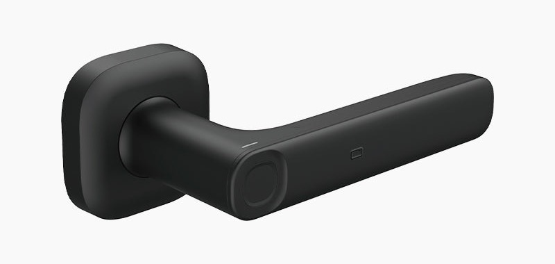

# FIDO R2 for Home Assistant

Unlock and monitor a **YEEUU / FIDO R2** smart lock with **100% local, cloud-free** operation over Bluetooth from Home Assistant. A connectable Bluetooth adapter or proxy is required, but the official YEEUU H1 Wi-Fi/Bluetooth gateway is not. The account-assisted setup contacts Tuya once to retrieve the lock credentials. This lock sometimes also appears as **R1 Smart Lock** in Tuya apps. The integration was developed with one YouJia **YSR3711**, product ID `jiqwweph`, using Tuya BLE protocol 2.0. Compatibility with other hardware is not established.

[YEEUU product page](https://www.yeeuu.com/collections/smart-lever-knob-handle-latch-lock/products/r2-fido-smart-lock) · [Original FIDO Indiegogo campaign](https://www.indiegogo.com/projects/fido-the-safest-and-most-minimalist-smart-lock)

## What it does

- **Unlock** sends an authenticated Bluetooth request and reports success after the lock acknowledges it.
- **Prepare connection** connects in advance and keeps the session for up to 60 seconds, so a subsequent unlock can be faster. Press it again to renew the window. This can be used inside Home Assistant automations (e.g. upon doorbell ring).
- **Last fingerprint unlock** shows the name of the most recently received fingerprint record. Its attributes include the slot ID, the lock-reported time and recent records. This can be triggered by a Home Assistant automation (e.g. upon door opened using a contact sensor).

Fingerprint records are received during authenticated Bluetooth sessions, including records queued while disconnected.

## Before you begin

1. Set up the lock in one of the compatible mobile apps first. For iPhone: [YEEUU](https://apps.apple.com/sg/app/yeeuu/id1484451131), [Smart Life](https://apps.apple.com/sg/app/smart-life-smart-living/id1115101477), or [Tuya Smart](https://apps.apple.com/sg/app/tuya-smart/id1034649547). App availability varies by region. Android versions are expected to work similarly, but Android setup has not been tested with this integration.
2. Make sure Home Assistant has a **connectable** Bluetooth adapter or active Bluetooth proxy within range of the lock. A passive-only proxy cannot make the connection. See [ESPHome’s Bluetooth proxy projects](https://esphome.io/projects/?type=bluetooth) for compatible hardware and setup. Once set up, the integration operates locally; an H1 gateway and internet connection are not required once the initial setup is completed.
   **TODO:** Add a specific recommended Bluetooth proxy and purchase link after testing.
3. For account-assisted setup, have the **account email**, **password**, and the **registered region** (it's the country calling code) ready. For example, Singapore is `65`. You need internet access for this one-time lookup.
**Note:** Do not reset or unpair a working lock just to install this integration.

## Install

The repository can be installed as a **custom repository** through the Home Assistant Marketplace (formerly HACS). The button opens the repository in your own Home Assistant; it does not install anything until you confirm there.

1. Select the **Open the repository in Home Assistant** button above. If prompted, enter the address of your Home Assistant instance into My Home Assistant.
2. In Marketplace, add the repository as a custom **Integration** if asked, then select **Download** or **Install**.
3. Restart Home Assistant so it can load the new integration and its dependencies.
4. Go to **Settings → Devices & services → Add integration**, search for **FIDO BLE Unlock**, and open it.

If the button doesn't work, add `https://github.com/s0ftice/ha-fido-r2` manually as an integration through HACS → custom repositories, or use **Marketplace → Add from link** where available. Then install it and restart Home Assistant.

The integration uses `tuya-ble-sdk==0.1.4` and `tuya-mobile==1.2.0`, which Home Assistant installs from the integration manifest. Do not add a second integration entry if you are replacing a manually installed copy: preserve the existing entry and back up the installation before switching files.

## Set up the lock

### Option A: Retrieve the local key from an app account

1. Select the account type you used to add the lock: **Smart Life**, **Tuya Smart**, or **YEEUU/Ujia**. Accounts in different apps may be separate even when they use the same email address.
2. Enter the app account email, password, and account registered region (country calling code). The password is used for the lookup and is not saved in the integration configuration.
3. The integration searches for the known FIDO R2 product ID. If it finds one lock, it selects it; if it finds several, select yours. If no compatible lock is found, check the account and use manual setup if necessary.
4. Review the displayed lock Bluetooth address, device ID and UUID. When available, these are filled from the account response. If an item is missing, enter it manually. Home Assistant selects a connectable adapter automatically.
5. Enter the **Bluetooth unlock member ID**. The default is `1`.
6. Optionally enter fingerprint names as a JSON object, for example `{"1": "Alex", "4": "Sam"}`. Use `{}` if you don't know the slot IDs yet. Select **Submit**.
7. Open the FIDO R2 device page. Test **Prepare connection**, then press **Unlock** while you can observe the door.

### Option B: Enter the credentials manually

1. Choose **I already know the local key**.
2. Enter the lock's connectable Bluetooth address, 16-character Tuya device ID, 16-character Tuya device UUID and 16-character lock local key. The UUID is separate from the device ID. A gateway's LAN key is not necessarily the lock's BLE key.
3. Enter the member ID and optional fingerprint-name mapping as described above, then submit and test the buttons.

The device ID is often shown in the mobile app's device information. The UUID and lock key may not be shown there; their availability from Tuya interfaces depends on the account and device. Account-assisted setup is intended to retrieve them where supported. If you use a YEEUU H1 Wi-Fi/Bluetooth gateway, you can use the [Tuya Developer Platform](https://developer.tuya.com/en/) to retrieve the local key. 

## Reconfigure and history

Open **Settings → Devices & services → FIDO BLE Unlock → Reconfigure** to update the lock details or fingerprint names. Leave the replacement local key field blank to keep the existing key.

Fingerprint IDs, names and timestamps describe household activity and are stored locally in Home Assistant.

## Credits and license

Built with help from [OpenAI Codex](https://openai.com/codex/).
The configuration script was adapted from [Noneawe's `get_local_key.py`](https://github.com/Noneawe/tuya-ble-esphome-battery/blob/main/tools/get_local_key.py).
This integration uses [tuya-ble-sdk](https://github.com/roquerodrigo/tuya-ble-sdk) and [tuya-mobile](https://github.com/AboveColin/tuya-mobile).

This integration is distributed under the [MIT License](https://github.com/s0ftice/ha-fido-r2/blob/main/LICENSE).
